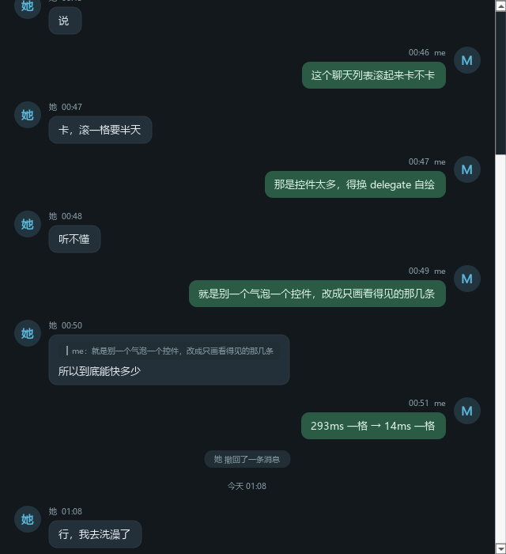

# Y-component-library

自用的一个"组件 + 应用"合集。能单独拿走的放 `packages/`，能整套部署的放 `apps/`。



---

## 目录

### 🧩 组件 `packages/`

| 部件 | 说明 | 文档 |
|---|---|---|
| [chatview](#chatview) | PySide6 聊天记录视图，几千条消息不卡 | [docs/chatview.md](docs/chatview.md) |

### 🚀 应用 `apps/`

| 部件 | 说明 | 文档 |
|---|---|---|
| [YehoChat](#yehochat) | 自建小圈子聊天：Python 服务端 + Android 客户端 | [docs/yehochat.md](docs/yehochat.md) |

### 📖 文档 `docs/`

| 文档 | 内容 |
|---|---|
| [chatview 组件用法](docs/chatview.md) | API、设计取舍、测试、截图 |
| [YehoChat 总览](docs/yehochat.md) | 有什么、怎么跑、设计选择 |
| [部署方案](docs/yehochat-deploy.md) | systemd + nginx + 证书 + 管理口令 |
| [协议要点](docs/yehochat-protocol.md) | 登录 / 收发 / 撤回 / 名册 / 身份 |

---

## chatview

一个能扛住几千条消息的聊天记录视图。不是"又一个气泡控件"——它换掉了渲染模型：

- 一格滚轮 **293ms → 14ms**（QScrollArea 堆控件 → QListView + delegate 自绘）
- 撤回时**只重绘一行**，滚动位置不动（曾经整表 reset 会让列表跳一下）
- 新消息**不把你从历史里拽走**，只有在底部时才自动跟随

```bash
cd packages/chatview
pip install pyside6
python examples/demo.py
```

```python
from ycomponent.chatview import ChatView, Message

view = ChatView(my_uid=1, name_of=lambda m: m.name, theme="dark")
view.set_messages([Message(uid=1, name="我", text="在吗", mine=True)])
view.append_message(Message(uid=2, name="她", text="在"))
```

细节（几何缓存、时间分隔、引用块、浮标）见 [docs/chatview.md](docs/chatview.md)。

## YehoChat

十几个人、长期住一个房间、不依赖第三方平台。有账号体系、引用/撤回、改名广播、多设备同时在线、管理端。

```bash
cd apps/yehochat/server
pip install -r requirements.txt
python gen_cert.py                 # 首次：自签证书
python server.py                   # :8705 聊天（WSS）
python chat_users.py               # :8706 账号与管理
```

Android 端在 `apps/yehochat/android`，服务器地址走 gradle 属性，不写进源码。
完整步骤见 [docs/yehochat-deploy.md](docs/yehochat-deploy.md)，协议见 [docs/yehochat-protocol.md](docs/yehochat-protocol.md)。

---

## 仓库结构

```
packages/                 可复用组件（pip 装得走的那种）
└─ chatview/              PySide6 聊天记录视图
   ├─ ycomponent/         源码（import ycomponent.chatview）
   ├─ examples/           demo + 离屏截图脚本
   ├─ tests/              headless 冒烟测试
   └─ pyproject.toml

apps/                     完整应用（要部署的）
└─ yehochat/              自建小圈子聊天
   ├─ server/             Python 服务端（3 个进程）
   └─ android/            Android 客户端

docs/                     文档（见上方索引）
```

## 安全

仓库里**没有任何真实凭据**：服务器地址、签名密钥、SMTP 密码、OSS AccessKey 全部走环境变量或本地未跟踪文件（`.env`、`keystore.properties`、`*.p12` 都在 `.gitignore` 里）。

## 测试

```bash
cd packages/chatview
QT_QPA_PLATFORM=offscreen python tests/run_tests.py    # 不装 pytest 也能跑
QT_QPA_PLATFORM=offscreen python -m pytest tests -q
```

CI 在 `.github/workflows/test.yml`，同一套命令。

## License

MIT
