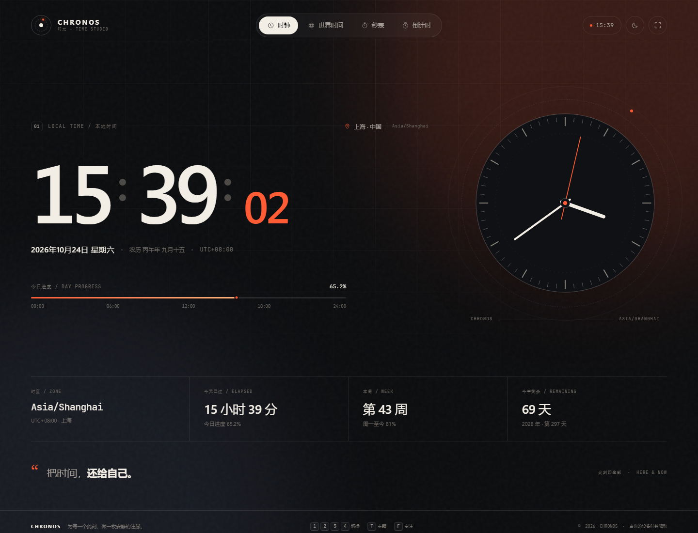

# CHRONOS · 时光

一个安静、克制、无需构建的在线时间网站。实时时钟、世界时间、秒表与倒计时，都在同一个页面里。



## 功能

- **本地时钟**：超大数字时间、指针时钟、农历日期、UTC 偏移、今日进度与年度统计。
- **世界时间**：本地 + 8 个城市（本地时区与之重复时去重，实际显示本地 + 7 个），自动处理夏令时，显示相对时差与昼夜状态。
- **秒表**：百分秒精度（10ms 刷新）、计次记录、最快分段标记，支持键盘操作。
- **倒计时**：快捷时长、自定义分钟 / 秒、圆环进度、暂停继续、结束提示音；运行中把剩余时间写进标签页标题。
- **专注视图**：隐藏页头、页脚、侧栏与统计条，保留时间主体、日期行、今日进度条和退出按钮。按 `F` 进入，`Esc` 退出。
- **明暗主题**：首次加载读系统偏好，之后以手动切换为准并记住。
- **响应式布局**：桌面、平板与手机均有独立适配。

## 打开方式

零依赖、零构建，直接双击 `index.html` 即可。

也可以在当前目录启动任意静态服务器：

```bash
python -m http.server 8000
```

然后访问 `http://localhost:8000`。

## 快捷键

| 按键 | 功能 |
| --- | --- |
| `1` `2` `3` `4` | 切换时钟 / 世界时间 / 秒表 / 倒计时 |
| `←` `→` | 在标签栏内左右切换 |
| `Home` `End` | 跳到第一个 / 最后一个标签 |
| `Space` | 开始或暂停当前计时工具 |
| `L` | 秒表计次 |
| `T` | 切换明暗主题 |
| `F` | 进入或退出专注视图 |
| `Esc` | 退出专注视图 / 取消倒计时输入 |

也支持 URL 深链：`index.html#stopwatch`、`#world`、`#timer`。

## 文件

```text
apps/chronos/
├── index.html   # 页面结构
├── styles.css   # 视觉样式与响应式布局
├── app.js       # 时钟、时区、秒表与倒计时逻辑
├── preview.png  # 界面预览图
├── README.md    # 这份精简说明（完整文档见 docs/chronos.md）
└── deploy/      # Nginx 配置
```

所有时间均由浏览器系统时钟实时计算；世界时区与夏令时规则来自浏览器内置的 `Intl` 数据。
页面不依赖任何外部资源，首次加载后断网仍可继续运行（没有 Service Worker，断网刷新不在保证范围内）。
