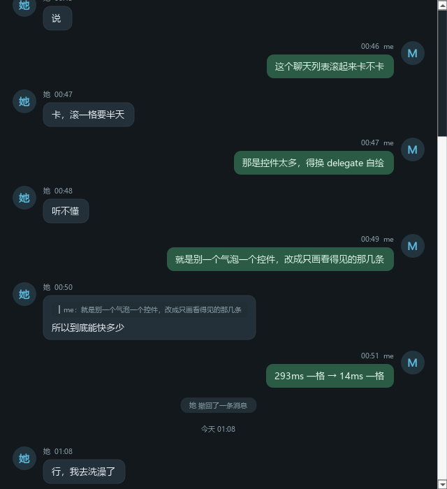

# chatview —— PySide6 聊天记录视图

`packages/chatview`。运行时只依赖 `pyside6`，没有其它运行时依赖。

```bash
cd packages/chatview
pip install -e .               # 装成本地包，让 `import ycomponent` 能找到
python examples/demo.py        # 带假消息的 demo，每 4 秒来一条新消息
```

> `pip install -e .` 这一步不能省：`demo.py` 用的是 `from ycomponent.chatview import ...`，
> 直接 `python examples/demo.py` 时 `sys.path[0]` 是 `examples/`，包没装就会 `ModuleNotFoundError`。
> 不想装包也行，把 `PYTHONPATH` 指到 `packages/chatview`：`PYTHONPATH=. python examples/demo.py`（Windows：`$env:PYTHONPATH="."; python examples/demo.py`）。



## 为什么不用 QScrollArea

最初的版本把每条消息做成一个 `QWidget` 塞进 `QScrollArea`，于是：

| 现象 | 原因 | 结果 |
|---|---|---|
| 一格滚轮卡 293ms | 120 个气泡控件整屏重绘，每个 QLabel 重解析一次全局 QSS | 没法用 |
| 往上翻历史"被无形的手拽回底部" | 滚动条按需显示 → 视口变窄 → 气泡重新换行 → 高度变 → 滚动条再切换 | 死循环 |
| 撤回一条消息，整个列表跳一下 | `model.reset()` 让所有行重新布局 | 位置丢失 |

换 `QListView + QAbstractListModel + QStyledItemDelegate` 之后：一格滚轮 14ms（约 70fps），只有可视的十来行被绘制。

## 用法

```python
import time

from PySide6.QtWidgets import QApplication
from ycomponent.chatview import ChatView, Message

app = QApplication([])
view = ChatView(my_uid=1, name_of=lambda m: m.name, theme="dark")
view.set_messages([
    Message(uid=1, name="我", text="在吗", mine=True),
    Message(uid=2, name="她", text="在", ts=time.time()),
])
view.append_message(Message(uid=2, name="她", text="新消息"))
view.show()
app.exec()
```

> `ts` 是 `float` 秒级时间戳（`time.time()`），不是字符串也不是 `datetime`。
> 省略它会被当成"当前时间"，但传一个非数字对象会在画时间分隔条时抛 `TypeError`。

## API

| 对象 | 作用 |
|---|---|
| `ChatView(my_uid=..., name_of=..., theme="light"\|"dark", separator_gap=300)` | 主控件，含列表 + 浮标 |
| `view.set_theme("dark")` | 换主题（重设 palette 并重绘，不重建控件） |
| `view.set_messages(list)` | 一次性装载，自动插时间分隔条 |
| `view.append_message(m)` | 追加一条，按"是否在底部"决定滚不滚 |
| `view.replace_message(row, m)` | 原地替换一行（撤回用），不动滚动位置 |
| `view.scroll_to_bottom(*, force=False)` | 滚到底；`force` 是 keyword-only |
| `view.is_at_bottom()` | 是否在底部（60px 阈值） |
| `Message(uid, name, text, ts, mine, kind, quote)` | 数据对象；`kind` = `msg` / `time` / `recall` |
| `Message.from_dict(row, my_uid=...)` | 从字典构造（`my_uid` 相同则自动置 `mine`） |
| `ChatModel.row_of(predicate)` | 按条件找行号，找不到返回 `None`（撤回时定位用） |
| `ChatModel` / `ChatDelegate` | 想自己组装 `QListView` 时直接用 |
| `fmt_separator(ts)` | 时间分隔文案：`今天 12:34` / `昨天 12:34` / `11-14 12:34` / `2025-11-14 12:34` |

`name_of` 是回调 `Message -> str`，用来把 uid 解析成当前昵称（改过名的人，历史消息也要跟着改）。

## 设计取舍

- **不用 QSS 给气泡上色**。颜色全部来自 `theme.py` 的两份 palette，delegate 直接 `QPainter` 画；换主题 = 换 dict 再重绘。
- **几何结果缓存**。`_geom()` 按 `(时间, uid, 正文, 是否自己发的, 是否有引用, 可用宽度)` 6 项缓存 —— 中文换行测量很贵，滚动时每帧都会问。用 `uid` 而不是昵称做键，昵称改了不会让缓存失效。
- **引用块会撑宽气泡**，否则引用被挤成一条窄缝。
- **名称和时间按整行宽度画**，不贴气泡画，否则气泡很窄时出现"5 YEH…"这种断头文字。
- **不管网络和存储**。这个库只负责"给我一批 Message，画出来"。

## 测试

```bash
cd packages/chatview
pip install -e ".[dev]"          # 或者 pip install -e . pytest（测试要多装一个 pytest，运行时不依赖它）

python tests/run_tests.py         # 4 个用例，不依赖 pytest，脚本内部自己设了 offscreen
python -m pytest tests -q         # 同一批用例走 pytest
```

> `tests/run_tests.py` 和 `tests/test_chatview.py` 内部都会 `os.environ.setdefault("QT_QPA_PLATFORM", "offscreen")`，
> 所以不用手动加前缀。真要手动指（比如在 Windows PowerShell 里），写法是
> `$env:QT_QPA_PLATFORM="offscreen"; python tests/run_tests.py`，
> `QT_QPA_PLATFORM=offscreen python ...` 这种是 POSIX shell 的写法，PowerShell 里会报错。

4 个用例：时间分隔条、单行替换不改变行数、**"看历史时新消息不能把视图拽到底部"**、分隔条文案。

## 截图

`examples/shot.py` 用 `view.grab()` 离屏出图，本地跑（CI 目前只跑测试，不跑来图脚本）：

```bash
python examples/shot.py          # 输出到 examples/ 下
```

> 坑：offscreen 平台没有字体，中文会渲染成方块。必须先 `QFontDatabase.addApplicationFont("C:/Windows/Fonts/msyh.ttc")`（脚本里已处理）。

## 已知限制

- 只验证了 PySide6 6.12 / Windows；PyQt6 需要替换 `Signal` 导入，未测。
- 不支持富文本：只有纯文本 + emoji。要 Markdown 气泡得自己扩展 delegate 的绘制分支。
- 没有输入框、没有表情面板 —— 只做记录视图。
