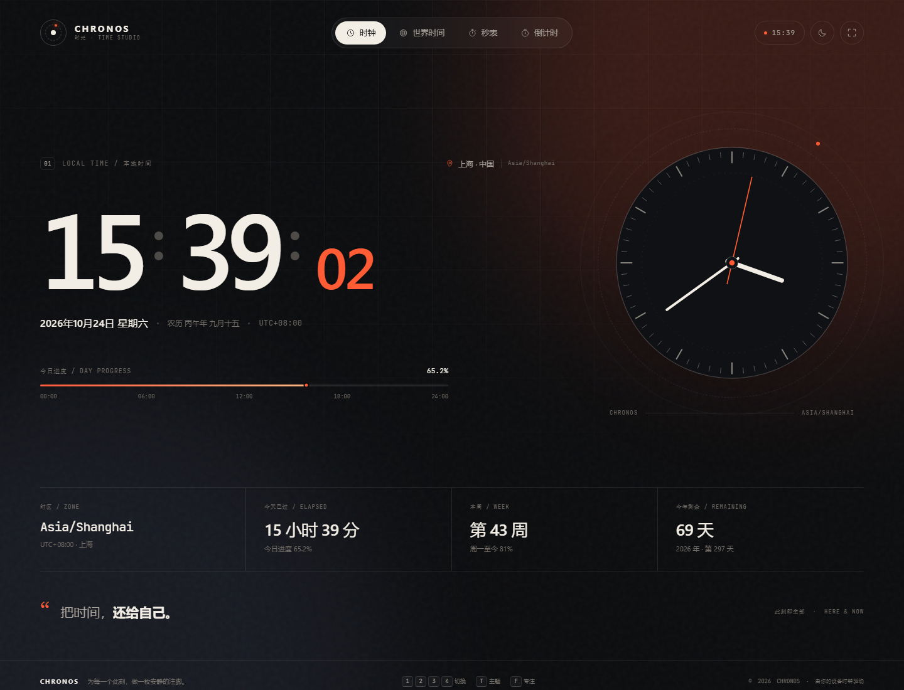

# CHRONOS · 时光 —— 在线时钟

`apps/chronos`。一个安静、克制、**零依赖零构建**的在线时钟网站：双击 `index.html` 就能用。



## 功能

- **本地时钟**：超大数字时间、指针时钟、农历日期、UTC 偏移、今日进度与年度统计
- **世界时间**：本地 + 8 个城市。本地时区正好是这 8 个之一时，列表中会去重，实际显示本地 + 7 个；自动处理夏令时，显示相对时差与昼夜状态
- **秒表**：百分秒精度（`10ms` 刷新，显示 `.00`～`.99`）、计次记录、最快分段标记，支持键盘操作
- **倒计时**：快捷时长、自定义分钟/秒、圆环进度、暂停继续、结束提示音；运行中会把剩余时间写进标签页标题
- **专注视图**：隐藏页头/页脚/侧栏/统计条，只保留时间主体，以及日期行、今日进度条和右上角退出按钮（`F` 进入，`Esc` 退出）
- **明暗主题**：首次加载时读系统偏好，之后以手动切换的结果为准并记住；运行中改系统设置不会实时跟随
- **响应式**：桌面、平板、手机各有独立适配

## 本地打开

```bash
cd apps/chronos
python -m http.server 8000     # 然后访问 http://localhost:8000
```

或者直接双击 `index.html`。

## 快捷键

| 按键 | 功能 |
|---|---|
| `1` `2` `3` `4` | 切换 时钟 / 世界时间 / 秒表 / 倒计时 |
| `←` `→` | 在四个标签之间左右切换（焦点在标签栏时） |
| `Home` `End` | 跳到第一个 / 最后一个标签 |
| `Space` | 开始或暂停当前计时工具 |
| `L` | 秒表计次 |
| `T` | 切换明暗主题 |
| `F` | 进入或退出专注视图 |
| `Esc` | 退出专注视图 / 取消倒计时输入 |

另外支持 URL 深链：`index.html#stopwatch`、`#world`、`#timer` 直接打开对应标签。

## 文件

```
apps/chronos/
├── index.html          页面结构
├── styles.css          视觉样式与响应式布局
├── app.js              时钟、时区、秒表与倒计时逻辑
├── preview.png         界面预览
├── README.md           精简版说明（完整文档就是这份 docs/chronos.md）
└── deploy/nginx.conf   Nginx 配置（静态托管 + 缓存 + 安全头）
```

## 为什么是纯静态

所有时间都由浏览器系统时钟计算，世界时区与夏令时规则来自浏览器内置的 `Intl` 数据。
**页面不请求任何外部资源**，首次加载完成后断网仍能继续运行（没有 Service Worker，断网后刷新不在保证范围内），也因此部署时不需要任何后端——见 [部署方案](chronos-deploy.md)。

## 部署

Nginx 的完整配置在 [`apps/chronos/deploy/nginx.conf`](../apps/chronos/deploy/nginx.conf)，步骤见 [chronos-deploy.md](chronos-deploy.md)。
